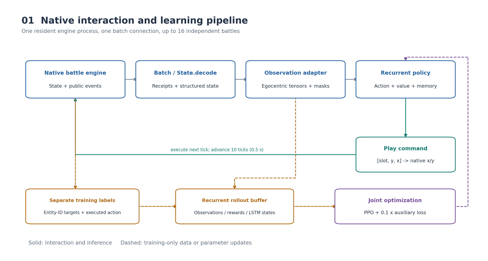
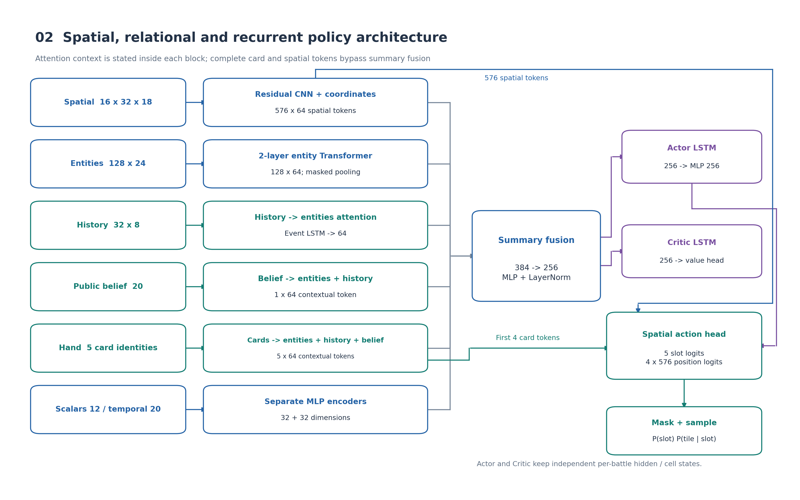
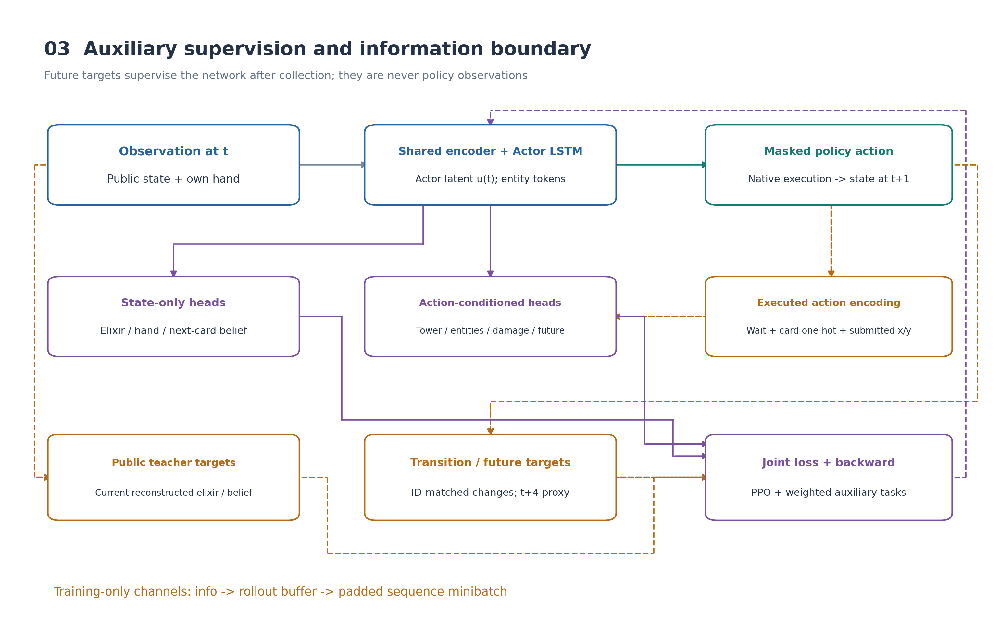
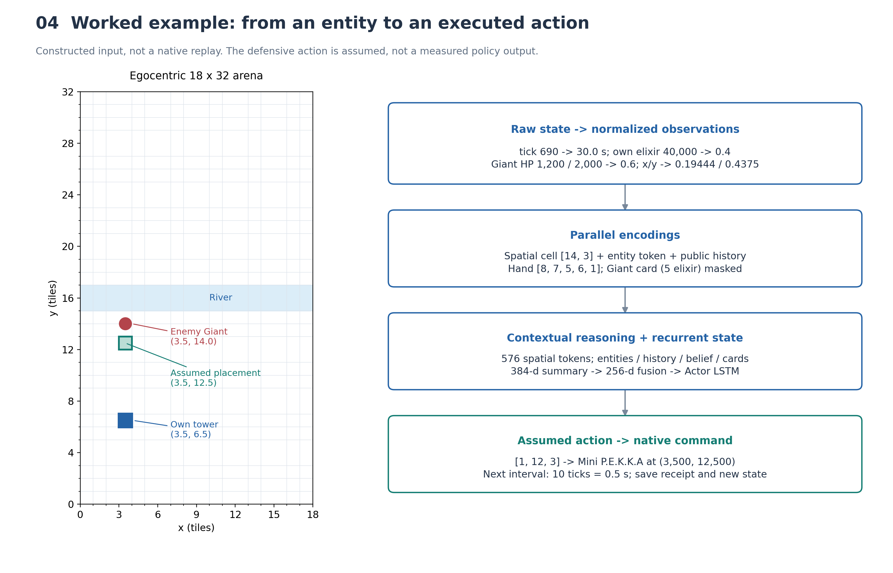
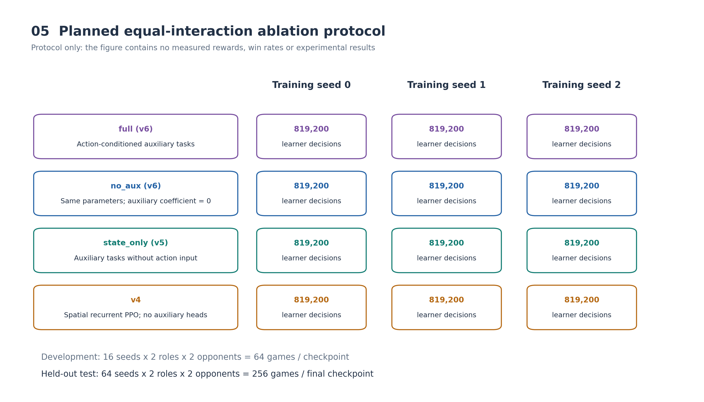

# 面向皇室战争固定卡组镜像对战的空间保持与动作条件辅助预测循环强化学习方法

*Spatially Preserving Recurrent Reinforcement Learning with Action-Conditioned Auxiliary Prediction for Fixed-Deck Mirror Matches in Clash Royale*

## 摘要

皇室战争对战同时涉及局部空间部署、实体交互、卡牌循环与隐藏资源推断。单一时刻的战场快照难以充分表达对手的出牌历史与攻防演化，而将空间特征压缩为全局向量又可能削弱对精细部署位置的表达。针对固定八张卡牌的镜像对战任务，本文构建一种基于原生战斗引擎的循环强化学习方法。该方法将结构化状态转换为空间网格、实体集合、公开事件序列、手牌与对手卡序信念等多路观测，采用保持原始网格分辨率的残差卷积网络、实体 Transformer 和定向交叉注意力建立联合表示，并利用事件 LSTM 与持续 Actor/Critic LSTM 分别处理显式出牌序列和跨决策记忆。策略通过带合法性掩码的分层动作分布选择卡牌与条件落点。训练阶段进一步引入动作条件辅助预测：以原生成功回执及公开出牌事件确认的卡牌和提交落点作为条件，预测相邻状态变化与短期局面指标；对手当前资源和卡序预测仅使用状态表示。实体转移标签通过原生 ID 对齐生成，经独立训练通道传递，避免将未来标签加入策略观测。本文给出问题形式化、观测编码、网络结构、联合优化目标、数据流示例，以及基于等交互预算、多随机种子和独立固定赛程的实验设计。本文当前版本不报告正式对战实验结果，也不预先断言所述模块能够提高策略强度。

**关键词：** 皇室战争；部分可观测决策；循环强化学习；实体注意力；空间动作分布；辅助动力学预测；自博弈

## 1 引言

实时卡牌策略对战要求智能体在资源约束下协调出牌时机、卡牌选择与部署位置。以皇室战争为例，某个位置是否适合部署单位，不仅取决于附近单位的分布，还取决于单位身份、攻击目标、部署延迟、双方圣水以及对手可能持有的反制牌。同样的当前战场可能由不同历史过程形成，其后续风险也可能不同。因此，决策系统需要同时处理空间结构、对象关系与时间上下文。

该任务至少包含三个表征问题。首先，局部地图有利于识别阵型与接触区域，但同一网格中的多个单位会被聚合，不能完整保留对象身份。其次，实体列表能够区分单位，却不能自动提供适合卷积处理的局部空间结构。最后，对手手牌与实际圣水不应直接提供给决策网络，智能体需要利用公开事件进行推断，并通过持续记忆保留观察历史。上述问题不能仅通过扩大一个全局特征向量来直接解决。

本文围绕当前仓库已经实现的原生引擎接口与策略网络，研究固定八张卡牌的镜像对战。系统在 Android 模拟器中的兼容客户端原生战斗引擎上运行，通过结构化状态接口推进对局。观测不依赖截图识别，原生引擎中的状态也不直接等同于允许策略使用的信息：环境适配器只向学习方提供自己的手牌与资源，以及当前实现定义的公开实体和出牌事件。对手隐藏手牌与真实圣水不进入学习方观测。

本文的方法设计包括以下三个方面：

1. **面向部署的联合表示。** 保留完整空间位置 token，并通过实体 Transformer 与历史、belief、手牌的定向交叉注意力，构造具有当前场面条件的卡牌表示。
2. **显式事件与持续决策记忆的组合。** 事件 LSTM 编码最近成功出牌序列，Actor/Critic LSTM 跨决策保存独立隐状态，配合按环境槽位重置与序列训练。
3. **实际执行动作条件下的辅助学习与可核验评估。** 独立传递转移标签和执行动作，联合优化 PPO 与辅助预测损失，并用共享冻结对手、独立测试种子和等交互预算构造消融比较。

这些内容属于已实现的系统与方法设计，其策略收益仍需正式实验检验。本文不将标准 CNN、Transformer、LSTM 或 PPO 的使用本身宣称为算法首创，也不把工程前向检查视为胜率或样本效率证据。

## 2 相关工作

### 2.1 策略优化与部分可观测条件下的记忆

PPO 通过裁剪策略概率比构造替代优化目标，使同一批采样轨迹能够用于多轮小批量更新 [1](https://arxiv.org/abs/1707.06347)。GAE 利用价值函数和衰减的时间差分残差估计优势，调节估计偏差与方差 [2](https://arxiv.org/abs/1506.02438)。本文在循环策略上采用这两种机制，而非重新定义策略梯度算法。

LSTM 通过门控单元处理序列状态 [3](https://doi.org/10.1162/neco.1997.9.8.1735)。在本文任务中，循环状态用于压缩过去的公开观察，不能保证构成真实隐藏状态的充分统计量。具体工程基于 SB3-Contrib RecurrentPPO，其推理接口需要显式传递循环状态与新局标记 [4](https://sb3-contrib.readthedocs.io/en/master/modules/ppo_recurrent.html)。本文在该实现之上增加固定长度的截断反向传播边界及独立辅助标签缓冲。

### 2.2 空间特征与实体关系

残差连接将网络变换写为输入与残差函数的组合 [5](https://arxiv.org/abs/1512.03385)。本文空间编码器采用这一结构，但仅使用小型自定义卷积主干，未使用预训练 ResNet。主干采用 GroupNorm，其归一化不依赖批次统计 [6](https://arxiv.org/abs/1803.08494)。

Transformer 的多头注意力通过 query、key 与 value 建模输入之间的交互 [7](https://arxiv.org/abs/1706.03762)。本文将结构化实体编码为 token，并使用实体自注意力与跨输入交叉注意力。此处的“跨模态”指空间地图、对象集合、公开事件和卡牌上下文之间的异构表示交互，不涉及文本或语言生成。空间卷积与实体注意力的组合是本文针对部署任务的表示设计，其必要性应通过受控比较验证。

### 2.3 合法动作掩码与辅助预测

在状态相关的离散动作空间中，可通过掩码将无效动作移出采样支持集；已有研究讨论了这一机制与策略梯度的关系 [8](https://arxiv.org/abs/2006.14171)。本文进一步将动作分解为手牌选择和该牌的条件位置分布，使位置合法性按卡牌分别表达。

辅助任务可以与强化学习目标共同训练共享表示 [9](https://arxiv.org/abs/1611.05397)。本文使用公开状态转移、公开卡序推断及短期局面代理量作为辅助监督。与 Dreamer 在学习模型的潜在想象轨迹中优化行为不同 [10](https://arxiv.org/abs/1912.01603)，本文的辅助预测不生成训练用想象轨迹，也不进入在线搜索或动作评分。为保持术语准确，下文使用“辅助世界模型”指这些有限维度的预测头，而不将其视为完整、可递归推进的环境模型。

## 3 问题定义与系统接口

### 3.1 固定卡组镜像对战

双方均采用同一组八张卡牌：骑士、弓箭手、亡灵、万箭齐发、火球、巨人、火枪手和迷你皮卡。本文研究范围限定于当前标准对局配置及非进化固定卡组，不包含完整卡池、未见卡牌或跨卡组泛化。

令原生对局状态为 $s_t$，学习方与对手在决策步 $t$ 的动作为 $a_t$ 和 $a_t^{\mathrm{opp}}$。引擎执行联合动作后推进固定 tick 数：

$$
s_{t+1}\sim P(s_{t+1}\mid s_t,a_t,a_t^{\mathrm{opp}}).
\tag{1}
$$

环境构造观测 $o_t=\mathcal O(s_t,\ell_{\le t})$，其中 $\ell_{\le t}$ 是已收到的公开事件账本。学习方根据观察历史选择动作；循环策略以有限维度记忆 $m_t$ 近似表达该历史：

$$
a_t\sim\pi_\theta(\cdot\mid o_t,m_{t-1}),\qquad
m_t=F_\theta(o_t,m_{t-1}).
\tag{2}
$$

对手隐藏卡序与资源使该问题具有部分可观测性。自博弈期间对手分布随训练更新，故本文不假设整个训练过程对应一个固定对手的平稳 MDP。式（1）描述原生环境转移，式（2）的训练目标是在给定对手采样机制下最大化期望折扣累计奖励。

### 3.2 决策步与原生 tick

当前实现一个 native tick 对应 $0.05$ s。首次可玩边界为 tick 90，经过的模拟时间为

$$
\tau_t=\max\{0,(\mathrm{tick}_t-90)\times0.05\}.
\tag{3}
$$

默认每次决策推进 10 ticks，即 $0.5$ s 模拟时间。本文所有“步”若无特殊说明均指策略决策步，而不是 native tick、公开出牌事件或墙钟时间。

### 3.3 原生交互与观测边界

原生 Probe 读取对局结果、玩家记录、实体状态和成功出牌事件。底层接口建立在仓库收录的 FirstLight 派生原生探针与兼容层之上，来源声明见 [NOTICE](../../vendor/firstlight/NOTICE)；本文不将其已有逆向工作视为本文新增算法贡献。Python Batch 客户端解码为 `State`，环境适配器再构造策略观测。最多 16 个独立战斗槽位共享一个 resident 原生进程和一条 Batch 数据连接；一次策略批次对应一次所有活跃槽位的批量推进。这里的并行指独立环境槽位与批量接口，不意味着 16 个原生战斗一定在 16 个处理器上同时执行。



**图1　原生交互与联合训练流程。** 实线表示交互与推理，虚线表示仅用于训练的数据传递或参数更新。图片为系统示意，不包含吞吐测量。矢量源见 [SVG](photo/fig01_system_pipeline.svg)。

原始接口能够携带双方玩家记录，但学习方的 `hand`、下一张牌与真实圣水只从己方记录读取；对手圣水与卡序输入由公开事件重建。原生命令参数只用于执行指令，不作为策略特征。实体 ID 用于排序、目标相对坐标计算和训练标签对齐，不作为实体 token 的数值输入。本文的信息边界依据当前接口定义，不能自动推广为所有其他游戏模式下的完整可见性规则。

环境终局时先保存该局终止观测及标签，再仅复位结束的槽位。存活对局不因此被额外推进。下一次策略计算通过新局标记重置对应循环状态。

### 3.4 坐标统一与动作定义

原生场地范围按当前 schema 表示为 $18000\times32000$，每个策略网格对应 $1000\times1000$ 原生坐标单位。玩家 0 保持原坐标；玩家 1 使用

$$
x'=18000-x,\qquad y'=32000-y.
\tag{4}
$$

之后以归一化坐标 $(x'/18000,y'/32000)$ 编码实体。网格位置由除以 1000 后向下取整得到，并裁剪到合法索引范围。统一视角下己方处于相同纵向侧；观测仍保留玩家方向标量。

动作表示为 $a_t=(c_t,r_t,k_t)$，其中 $c_t\in\{0,1,2,3,4\}$ 分别对应等待与四张当前手牌，$r_t\in\{0,\ldots,31\}$，$k_t\in\{0,\ldots,17\}$。等待规范化为 $(0,0,0)$。非等待动作映射到格子中心：

$$
x_{\mathrm{cmd}}=1000(k_t+0.5),\quad
y_{\mathrm{cmd}}=1000(r_t+0.5).
\tag{5}
$$

玩家 1 的指令坐标再逆变换回原生方向。策略槽位索引映射为当前 `HandCard.slot`，不能直接用固定卡牌编号替代。原生指令安排在下一 tick 执行。

## 4 方法

### 4.1 观测的多路结构

单场观测为九项结构化张量，见表1。批量推理时在每项前增加环境批次维 $B$。

**表1　策略观测及编码用途。**

| 输入 | 单场形状 | 编码用途 |
|---|---|---|
| `spatial` | $16\times32\times18$ | 空间卷积与落点表示 |
| `entities` | $128\times24$ | 实体关系与交叉注意力上下文 |
| `entity_mask` | $128$ | 屏蔽实体补零行 |
| `hand` | $5$ | 四张手牌与下一张牌 |
| `scalar` | $12$ | 当前资源、时间、皇冠与塔血 |
| `public_belief` | $20$ | 对手公开卡序推断 |
| `action_history` | $32\times8$ | 最近成功出牌的有序序列 |
| `temporal` | $20$ | 相邻决策之间的变化量 |
| `action_mask` | $5\times32\times18$ | 卡牌与位置的联合合法性 |

#### 4.1.1 空间与实体编码

实体 token 按原生 ID 升序排列，最多保留 128 个，并填充到固定长度。`native_model_v3` 的空间图由完整实体集合生成，超过 token 上限的对象仍参与空间聚合；其独立身份与属性仍未进入实体支路。训练记录超过上限的决策比例。

空间通道依次表达：双方占据标记、双方生命比例、兵／建筑／投射物的双方类型标记、双方部署剩余时间、双方攻击就绪程度和双方存在目标标记。血量比例定义为 $q=\operatorname{clip}(\mathrm{hp}/\mathrm{maxhp},0,1)$；部署剩余时间除以 3000 ms；冷却除以 5000 ms 后裁剪。空间攻击就绪通道写入 $1-\mathrm{cooldown}_{\mathrm{norm}}$。同格实体的生命比例、部署时间和攻击就绪程度取最大值，类型与占据写入标记；目标标记同样取最大值，避免同格无目标实体覆盖已有标记。空间编码不保留完整数量或每个对象的独立身份。

每个实体 token 的 24 维字段详见附录A。其卡牌身份使用 9 维类别编码，包含未知／塔类别及八张固定卡牌；目标关系保留有无目标和相对坐标，不保留目标 ID 或完整邻接图。缺失血量与相关时序字段在编码中以零处理，不能将这些数值自动理解为所有实体类型的真实零值。

#### 4.1.2 标量、手牌与变化量

`hand` 按当前槽位给出四张手牌及下一张牌。卡牌编号 1—8 依次对应骑士、弓箭手、亡灵、万箭齐发、火球、巨人、火枪手、迷你皮卡，0 为填充／未知。卡牌身份在实体中采用类别向量，在历史中采用编号除以 8 的标量，在手牌中采用 Embedding；当前实现尚未统一这三种编码。

己方圣水采用原生定点单位，10000 对应一点圣水，故标量输入为原值除以 100000。其余标量包括对手公开估计圣水除以 10、双方皇冠除以 3、时间除以 300、三个圣水阶段标记、方向标记、双方总塔血比例以及历史长度除以 32。

令双方初始总塔血为 $H_0^{\mathrm{own}}$、$H_0^{\mathrm{opp}}$，当前总塔血比例分别为 $\eta_t^{\mathrm{own}}$、$\eta_t^{\mathrm{opp}}$。总塔血仅统计当前 schema 中 `card=-1` 的建筑实体。`temporal` 包含相邻状态塔血与圣水变化、非塔实体的生成／消失、战斗实体总血量变化、出牌与皇冠变化、具有目标的实体数量变化、实体数量变化，以及有效标记与 tick 间隔。详细尺度见附录A。实体消失包含投射物生命周期结束，不能统一解释为战斗单位死亡。

#### 4.1.3 公开事件与圣水重建

环境维护完整公开账本用于圣水与卡序推断，另保留最近 32 次成功出牌供网络编码。事件包含出牌方、卡牌、费用、时刻和提交坐标。原生公开事件本身不直接携带部署坐标，环境从对应成功回执与提交指令补入；无法匹配时坐标默认为零。因此，历史位置是提交位置记录，不保证等于引擎修正后的所有生成单位坐标。

对手圣水估计从 5 点开始，按事件间恢复、10 点封顶、费用扣除顺序递推。当前恢复规则为

$$
v(\tau)=
\begin{cases}
1/2.8,&0\le\tau<120,\\
1/1.4,&120\le\tau<240,\\
3/2.8,&\tau\ge240.
\end{cases}
\tag{6}
$$

对相邻出牌时刻 $\tau_{j-1},\tau_j$，费用为 $d_j$：

$$
\hat e_j^-=\min\left(10,\hat e_{j-1}^++\int_{\tau_{j-1}}^{\tau_j}v(u)\,du\right),\quad
\hat e_j^+=\max(0,\hat e_j^- -d_j).
\tag{7}
$$

最后恢复到当前时刻并封顶。这是当前标准任务下的公开规则估计，非对手真实圣水读取，也非网络学习出的精确隐藏状态。

#### 4.1.4 卡序信念

初始候选状态 $\omega=(\mathcal H,\mathcal Q)$ 由四张无序手牌与四张有序循环队列组成。对固定八张卡，有 $8!/(8-4)!=1680$ 个候选初始队列，每个赋予相同初始权重。观察对手打出卡牌 $d$ 时，保留 $d\in\mathcal H$ 的状态，并更新为

$$
\mathcal H'=(\mathcal H\setminus\{d\})\cup\{\mathcal Q_0\},\qquad
\mathcal Q'=(\mathcal Q_1,\mathcal Q_2,\mathcal Q_3,d).
\tag{8}
$$

相同后继状态的权重相加，得到归一化权重 $p_t(\omega)$。八张牌的在手概率与下一张概率分别为

$$
b_t^{\mathrm{hand}}(d)=\sum_\omega p_t(\omega)\mathbf1[d\in\mathcal H_\omega],\quad
b_t^{\mathrm{next}}(d)=\sum_\omega p_t(\omega)\mathbf1[d=\mathcal Q_{\omega,0}].
\tag{9}
$$

候选非空时，前者和为 4，后者和为 1。候选为空时实现返回零概率，故不能将所有输入都假定为有效后验。该算法仅对符合循环规则的候选加权，不按对手的选牌偏好计算出牌似然，宜称为**公开规则一致性信念**。附加置信指标为 $1-\log(\max(|\Omega_t|,1))/\log1680$；它基于候选数量，不等于经过校准的预测置信度，候选为空时也不能凭该指标判断推断正确。

实现为每个槽位的双方分别保存候选权重，仅在收到新的公开出牌事件时推进并汇总；每次观测直接读取当前信念。该增量计算与从完整公开序列重建的规则相同，避免重复重放整局卡序。单槽位复位时同时复位该槽位的候选状态。

### 4.2 空间保持与实体关系编码器

完整架构见图2，默认 token 宽度 $d=64$。



**图2　空间、关系与循环策略架构。** 交叉注意力的上下文在各模块内注明；摘要进入融合网络，而完整空间 token 和前四张卡牌 token 直接进入动作头。Actor 与 Critic 使用独立持续记忆。矢量源见 [SVG](photo/fig02_model_architecture.svg)。

#### 4.2.1 全分辨率残差 CNN

空间主干由 $3\times3$ 卷积（16→64）、8 组 GroupNorm、SiLU、两个保持尺寸的残差块和 $1\times1$ 卷积（64→64）组成。每个残差块使用两次 $3\times3$ 卷积和 GroupNorm，输出为输入与残差相加后经 SiLU 激活。所有卷积均保持 $32\times18$ 的高宽。

得到 $F_t\in\mathbb R^{64\times32\times18}$ 后，为每个位置 $p$ 添加坐标特征投影。令网格坐标线性映射为 $x_p,y_p\in[-1,1]$，其六维坐标特征为

$$
\phi(p)=[x_p,y_p,\sin(\pi x_p),\cos(\pi x_p),\sin(\pi y_p),\cos(\pi y_p)].
\tag{10}
$$

位置 token 为

$$
S_{t,p}=\operatorname{LN}(\operatorname{Flatten}(F_t)_p+W_{\mathrm{pos}}\phi(p)),
\qquad S_t\in\mathbb R^{576\times64}.
\tag{11}
$$

全局均值 $\bar S_t=576^{-1}\sum_pS_{t,p}$ 用于融合，完整 $S_t$ 用于动作落点。故本方法保留全局摘要与全位置表示两条路径，不从已池化向量或低分辨率插值图重建动作位置。

#### 4.2.2 实体 Transformer

实体输入经线性层（24→64）、LayerNorm 和 SiLU 投影，再进入两层 pre-norm Transformer Encoder；每层有 4 个注意力头，前馈宽度 256，激活为 GELU，dropout 为 0。实体 padding 在注意力中被屏蔽，输出记为 $E_t\in\mathbb R^{128\times64}$。

用可学习向量 $q_E$ 池化有效实体：

$$
\alpha_i=\operatorname{softmax}_{i\in\mathcal I_t}(E_{t,i}^{\top}q_E),\qquad
\bar E_t=\sum_{i\in\mathcal I_t}\alpha_iE_{t,i}.
\tag{12}
$$

完全空实体场景保留一个零 key 以避免注意力数值异常，并将摘要设为零。完整实体 token 继续作为交叉注意力的上下文。实体 ID 排序用于截断与标签对齐；编码器未添加“排序行号”位置嵌入，也未将原生 ID 作为特征。

### 4.3 定向交叉注意力与事件记忆

交叉注意力以待更新表示作为 query，以上下文作为 key/value。其单头基本形式为

$$
\operatorname{Attn}(Q,K,V)=\operatorname{softmax}(QK^\top/\sqrt{d_k}+M)V,
\tag{13}
$$

其中 $M$ 屏蔽无效上下文；本文使用四头实现，并在输出与 query 残差相加后归一化。

**历史查询实体。** 八维事件先投影到 64 维，得到 $U_t$。令

$$
\tilde U_t=\operatorname{LN}(U_t+\operatorname{MHA}(U_t,E_t,E_t)).
\tag{14}
$$

无效历史行在归一化后乘零掩码。有序有效事件进入单层 hidden size 64 的事件 LSTM，以最后有效事件的输出作为历史摘要 $\bar U_t$；没有事件时摘要为零。该 LSTM 在每次决策重新编码窗口，不跨决策保存 hidden state。由于历史无实体 ID，式（14）提供学习型关联，而非事件与对象的精确身份匹配。

**belief 查询实体与历史。** 将 20 维信念投影到 64 维 query $B_t^0$，上下文为完整实体与一个历史摘要 token：

$$
B_t=\operatorname{LN}\left(B_t^0+\operatorname{MHA}(B_t^0,[E_t;\bar U_t],[E_t;\bar U_t])\right).
\tag{15}
$$

**手牌查询实体、历史与 belief。** 五张卡牌的 Embedding 为 $C_t^0$，上下文为 $[E_t;\bar U_t;B_t]$：

$$
C_t=\operatorname{LN}\left(C_t^0+\operatorname{MHA}(C_t^0,[E_t;\bar U_t;B_t],[E_t;\bar U_t;B_t])\right).
\tag{16}
$$

无效牌 token 乘零掩码。五张有效牌的平均表示为 $\bar C_t$，前四张 $C_t^{1:4}$ 用于动作头。下一张牌只贡献状态上下文，不加入当前可选动作。

这一结构使不同卡牌可以从同一实体集合中提取不同上下文，但注意力权重本身不能证明因果解释，也不能证明网络已经学会某种反制规则。

### 4.4 融合与持续 Actor/Critic 记忆

当前标量与变化量分别经 Linear、LayerNorm、SiLU 得到 $g_t,q_t\in\mathbb R^{32}$。拼接输入为

$$
f_t=[\bar S_t;\bar E_t;\bar U_t;B_t;\bar C_t;g_t;q_t]\in\mathbb R^{384}.
\tag{17}
$$

Fusion MLP 使用 384→256→256 的两层变换，每层后有 LayerNorm 与 SiLU，得到 $z_t$。共享编码器向两个独立 LSTM 提供相同融合状态：

$$
(h_t^\pi,c_t^\pi)=\operatorname{LSTM}_\pi(z_t,h_{t-1}^\pi,c_{t-1}^\pi),\quad
(h_t^V,c_t^V)=\operatorname{LSTM}_V(z_t,h_{t-1}^V,c_{t-1}^V).
\tag{18}
$$

二者各一层、hidden size 256，再分别经 Linear（256→256）和 Tanh 得到 Actor latent $u_t$ 与 Critic latent $v_t$。价值输出为 $V_\theta(o_t,m_{t-1})=w_V^\top v_t+b_V$，目标为未来累计奖励，而非直接预测胜率。

每个环境槽位分别维护上述 hidden/cell state；新局标记在输入 LSTM 前将该槽位的状态清零。训练序列最长 32 个决策步，序列边界使用采样时保存的隐状态作为初始条件，截断梯度而不把该边界当作新局。事件窗口的 32 指成功出牌数，TBPTT 的 32 指决策步，二者没有固定对应关系；运行时隐状态亦无 32 步的硬截止记忆长度。

### 4.5 卡牌条件空间动作分布

对前四张卡牌形成 query：

$$
q_{t,c}=\tanh(W_CC_{t,c}+W_uu_t+b_q),\qquad c=1,\ldots,4.
\tag{19}
$$

每个空间位置形成 key $k_{t,p}=W_SS_{t,p}+b_S$，并生成落点 logits：

$$
L_{t,c,p}=q_{t,c}^{\top}k_{t,p}/\sqrt{64}+w_b^\top S_{t,p}+b_b.
\tag{20}
$$

等待 logit 由 $u_t$ 的线性层给出，四个手牌 logit 由各自 query 的共享线性层给出。动作头共输出 $5+4\times576=2309$ 个 logits，这不是 2309 个独立语义动作：完整未掩码语义动作包括一个等待和四张牌的落点，共 2305 个。

环境给出联合合法性 $A_t(c,p)$。卡牌合法性为 $\mathbf1[\exists p:A_t(c,p)=1]$；等待始终有效。掩码后的 slot softmax 与各牌位置 softmax 分别为 $P_t(c)$、$P_t(p\mid c)$，则

$$
\pi_\theta(a_t\mid o_t,m_{t-1})=
\begin{cases}
P_t(0),&c_t=0,\\
P_t(c_t)P_t(p_t\mid c_t),&c_t>0,
\end{cases}
\tag{21}
$$

非等待动作的 log-prob 为两个 log-prob 之和，等待只有 slot 项。训练和随机推理进行采样；当前确定性推理先取最高概率 slot，再取该牌最高概率位置，不保证等于所有联合动作概率的全局最大值。

掩码依据己方实际圣水、兵种部署区域与存活塔占位构造；摧毁敌方公主塔后扩大相应部署区域。当前两种法术可选整张地图。掩码是部署可行性约束，不判断战术收益。引擎回执仍用于核验实际执行。

### 4.6 动作条件辅助世界模型

#### 4.6.1 实际执行动作编码

定义 $\tilde a_t\in\mathbb R^{11}$，前 9 维为等待加八张卡牌的 one-hot，末两维为己方视角归一化提交坐标。只有学习方指令收到成功回执，且本次公开事件中存在相同出牌方和回执卡牌时，才编码为出牌；否则编码为等待并将坐标置零。

卡牌身份从原生回执读取，以避免换牌后用新手牌解释旧动作。坐标来自成功指令的提交落点，而非从生成单位坐标反推；引擎可能修正部署位置，故 $\tilde a_t$ 表示**已确认执行的卡牌及其提交坐标**。当前执行确认基于本步 owner/card 匹配，适用于当前每方每决策至多一张牌的接口约定。

该编码仅用于辅助动力学训练。PPO 的动作概率仍对应原始采样动作 $a_t$，不能用 $\tilde a_t$ 替换策略概率计算。

#### 4.6.2 状态与动作分支

Actor latent 投影为 $g_t^a\in\mathbb R^{128}$；动作编码投影为 $a_t^e\in\mathbb R^{128}$，两者拼接后经 256→128 的 Linear、LayerNorm、SiLU 得到动力学表示 $d_t$：

$$
g_t^a=f_g(u_t),\quad a_t^e=f_a(\tilde a_t),\quad d_t=f_d([g_t^a;a_t^e]).
\tag{22}
$$

当前对手圣水、手牌和下一张牌预测仅读取 $g_t^a$；塔血、粗粒度伤害类别与短期局面预测读取 $d_t$。实体辅助表示为

$$
r_{t,i}=\operatorname{SiLU}\left(\operatorname{LN}(f_E(E_{t,i})+W_dd_t)\right),
\tag{23}
$$

并分别输出消失 logit 与二维位移；位移输出经 Tanh。此模型没有对对手动作和后续完整动作序列显式条件化，预测结果对应 rollout 中对手响应及后续策略分布，不能解释为任意反事实动作的确定性后果。



**图3　辅助监督的信息边界。** 状态预测与动作条件预测共享 Actor 表示；未来观测和实体 ID 对齐结果作为独立训练目标，不送入当前 Actor/Critic 观测。图中参数更新指向共享网络，不表示预测结果反馈给当前动作头。矢量源见 [SVG](photo/fig03_supervision_boundary.svg)。

#### 4.6.3 标签、损失与任务边界

**表2　辅助任务、输出与默认权重。** $N=128$，BCE 指 logits 上的二元交叉熵；SL1 指 Smooth L1。

| 任务 | 单场输出 | 监督目标 | 损失 | 权重 |
|---|---:|---|---|---:|
| 塔血变化 | 2 | $t\rightarrow t+1$ 双方归一化总塔血变化 | SL1 | 1.0 |
| 实体消失 | $N$ | 当前非建筑实体在下一状态是否缺失 | BCE | 0.5 |
| 实体位移 | $N\times2$ | 存活非建筑实体的归一化位移 | SL1 | 0.5 |
| 伤害结果类别 | 5 | 公开状态变化构造的类别 | 交叉熵 | 0.25 |
| 对手圣水区间 | 5 | 当前公开估计圣水按约 2 点分档 | 交叉熵 | 0.25 |
| 对手可能手牌 | 8 | 当前规则信念的在手概率 | 软标签 BCE | 0.25 |
| 对手下一张牌 | 8 | 当前规则信念的下一张分布 | 软标签交叉熵 | 0.25 |
| 短期局面指标 | 1 | $t+4$ 的塔血与皇冠代理优势 | SL1 | 0.5 |

实体标签在环境中按原生 ID 精确对齐。当前观测保留的每个非建筑实体，在完整下一状态中查找同 ID；未找到时消失标签为 1，找到时为 0 并计算坐标差。位移损失仅对存活实体计算。建筑、padding 与不合法状态配对被排除；查找下一状态使用完整实体集合，避免下一状态 token 截断造成假消失。该标签不包含单位生成位置预测，也不是完整下一状态重建。

塔血与粗粒度伤害目标直接从复位前的相邻完整原生状态生成，不从新局观测重建。五类伤害结果按以下分数的最大值构造：

$$
\operatorname{argmax}\left(0,(-\Delta\eta^{\mathrm{own}})_+,(-\Delta\eta^{\mathrm{opp}})_+,
\ell^{\mathrm{own}},\ell^{\mathrm{opp}}\right),\qquad
\ell^s=\frac{\sum_{e\in U_t^s}(\mathrm{hp}_t(e)-\widetilde{\mathrm{hp}}_{t+1}(e))_+}
{\max(1,\sum_{e\in U_t^s}\max(1,\mathrm{maxhp}_t(e)))}.
\tag{24}
$$

其中 $U_t^s$ 为当前有公开血量、非投射物且非皇冠塔的实体集合，按 ID 查找下一状态；缺失实体的后继血量置零，缺失 maxhp 时回退到当前 hp。新增单位不进入该分母或损失和，因此新生成血量不会抵消旧单位受伤；投射物到期不构成伤害。训练标签版本为 `public_damage_result_v2`。该类别仍是归一化塔／单位损失的粗粒度结果代理，建筑到期等消失仍可能被计入损失；它不提供精确 attacker ID，也不是严格伤害事件分类。

当前对手圣水标签为 $\min(4,\lfloor5\hat e_t/10\rfloor)$。手牌和下一张牌标签均来自输入中的公开规则信念，因此属于公开信息的辅助表示约束，不能作为独立证明模型恢复真实隐藏状态的依据。

候选为空时，手牌和下一张分布的全零向量表示标签不可用。两项损失分别按非零概率和构造有效掩码，并从各自平均损失的分母中排除无效行；不能将全零手牌向量作为“八张牌均不在手”的负标签。独立辅助评分采用相同口径。

短期指标定义为

$$
y_t^{\mathrm{future}}=\eta_{t+4}^{\mathrm{own}}-\eta_{t+4}^{\mathrm{opp}}
+0.25\left(\kappa_{t+4}^{\mathrm{own}}-\kappa_{t+4}^{\mathrm{opp}}\right),
\qquad \kappa=\mathrm{crowns}/3.
\tag{25}
$$

默认 4 决策步约为 2 s。式（25）不是 Critic 回报标签，不含该时刻以后所有奖励；皇冠采用归一化数值。

独立标签通过 `info → rollout buffer → sequence minibatch` 与 $o_t$ 对齐。塔血、实体消失／位移和伤害结果按当前有效项直接监督，终局及 TBPTT 片段最后一项保留，padding 与无效实体行排除。未来指标在原始 rollout 时间顺序中生成后再随序列重排，可以跨 TBPTT／minibatch 切分；这只连接无梯度标签，不延长反向传播链。若 $t+4$ 恰为终局则使用终止观测，提前终局或 rollout 尾部缺少后继时排除，绝不把复位后的新局当作未来。

### 4.7 奖励与联合优化

#### 4.7.1 奖励

令 $D_t=\eta_t^{\mathrm{own}}-\eta_t^{\mathrm{opp}}$，$K_t=\mathrm{crowns}_t^{\mathrm{own}}-\mathrm{crowns}_t^{\mathrm{opp}}$，当前奖励为

$$
r_t=5(D_{t+1}-D_t)+2(K_{t+1}-K_t)+r_t^{\mathrm{end}}-0.05I_t^{\mathrm{invalid}},
\tag{26}
$$

胜利、失败和平局的终局项分别为 10、−10 和 0。$I_t^{\mathrm{invalid}}$ 表示尝试出牌但未被当前回执判定接受，包括被环境屏蔽的尝试。塔血归一化尺度在开局固定；观测标量另外进行区间裁剪。出牌成功本身不直接奖励，因此部署动作可能只有后续防守或进攻收益。

#### 4.7.2 PPO 与 GAE

记非终止标记为 $b_t$，时间差分残差与优势为

$$
\delta_t=r_t+\gamma b_tV_{\theta_{\mathrm{old}}}(o_{t+1},m_t)-V_{\theta_{\mathrm{old}}}(o_t,m_{t-1}),
\quad
\hat A_t=\sum_{l\ge0}(\gamma\lambda)^l\left(\prod_{j=0}^{l-1}b_{t+j}\right)\delta_{t+l}.
\tag{27}
$$

有限 rollout 在边界处按实现使用价值 bootstrap。优势在有效样本上标准化。定义策略比值

$$
\rho_t(\theta)=\exp\left(\log\pi_\theta(a_t\mid o_t,m_{t-1})-\log\pi_{\theta_{\mathrm{old}}}(a_t\mid o_t,m_{t-1})\right),
\tag{28}
$$

最小化的裁剪策略损失为

$$
\mathcal L_\pi=-\mathbb E_t\left[\min\left(\rho_t\hat A_t,
\operatorname{clip}(\rho_t,1-\epsilon,1+\epsilon)\hat A_t\right)\right].
\tag{29}
$$

循环更新从保存的序列初始状态展开；式（28）中的 $m$ 表示相应循环处理过程，而不是每个决策都从零开始。价值损失为目标回报与当前价值输出的均方误差，默认不启用价值裁剪。

#### 4.7.3 熵项与辅助项

当前分布的熵正则是加权版本：

$$
\mathcal H_w=0.001\,H(P_t(c))+0.00025\sum_{c=1}^4P_t(c)H(P_t(p\mid c)).
\tag{30}
$$

虽然训练配置中的外层 `entropy_coef=1.0`，有效 slot 与位置正则还乘以式（30）的内部系数，不能将其理解为系数为 1 的未经加权联合动作熵。

辅助损失为各任务在其有效掩码上的平均损失加权和：

$$
\mathcal L_{\mathrm{aux}}=\sum_j w_j\mathcal L_j,\qquad
\mathcal L=\mathcal L_\pi+0.5\mathcal L_V-1.0\,\mathbb E_t[\mathcal H_w]+0.1\mathcal L_{\mathrm{aux}}.
\tag{31}
$$

所有模块使用同一策略优化器完成联合 backward，梯度范数默认裁剪到 0.5。辅助任务通过梯度作用于其连接的共享模块；这不表示所有辅助任务对所有参数都具有非零梯度，例如仅依赖实体 token 的部分路径与 Critic 专有 LSTM 的连接不同。在线动作不读取辅助预测，Critic 也不读取这些未来标签。

### 4.8 训练与推理算法

**算法1　带独立辅助标签的循环 PPO 训练。**

```text
输入：16 路原生环境，策略参数 θ，公开事件账本，历史对手池
初始化各槽位对局、观测与 Actor/Critic hidden/cell state
重复执行每轮训练：
    在更新参数前收集 8192 个 learner 决策样本：
        用当前观测和该槽位记忆计算动作、价值、log-prob、新记忆
        为对手从其自身视角计算动作，并保留独立对手记忆
        将双方动作通过一次 Batch 请求提交，推进 10 ticks
        接收新状态、回执及公开出牌事件
        计算奖励；更新公开账本与下一观测
        以完整相邻原生状态生成 ID 对齐实体、塔血和伤害结果标签
        以成功回执和事件生成实际执行动作编码
        保存观测 t、采样动作、旧价值/概率、循环状态及独立标签
        对结束槽位保存 terminal 信息并单独复位
    计算 GAE 优势与目标回报；按原始时间顺序生成不跨新局的未来标签
    按 episode/TBPTT 边界构造最长 32 步的序列 minibatch
    重复 4 个 epoch：
        展开循环网络，重算价值、采样动作 log-prob 与加权熵
        从状态 t 及实际执行动作计算辅助预测
        在各自有效掩码上计算 PPO 与辅助损失
        联合反向传播、梯度裁剪、参数更新
    按固定周期保存更新后模型、联赛/RNG状态及开发评估快照
训练完成后，重载各轮快照依次执行开发评估（独立resident可实时执行）
输出：固定训练预算结束后的最终 checkpoint
```

推理时仅需要观测、循环状态与新局标记。Auxiliary World Model 参数可随 checkpoint 保存，但预测头不属于正常选牌路径。`train_native.py` 与一键入口共用默认 v6 profile 和运行时；旧 v5 类保留用于旧权重与消融。两个入口支持携带状态侧车的 `--resume`，恢复优化器、累计预算、历史对手、评级和 RNG。原生战斗内部状态无法恢复，续训从新对局开始，不保证逐步轨迹相同。

历史对手、固定评估及离线检查通过专用推理加载入口读取 checkpoint：SB3 初始化时只构造一步临时 rollout，加载后释放该缓冲区及不用的优化器状态。该入口保留模型参数和循环推理接口，不能用于恢复训练；续训继续使用标准加载路径。直接作为环境对手传入的 SB3 循环模型也按槽位持续传递记忆，并在对应新局标记处复位。

### 4.9 数据流的构造示例

图4给出一份构造输入，说明编码和坐标转换，不代表真实引擎轨迹，也不代表训练后的策略输出。设学习方为玩家 0，tick=690，己方圣水=40000，手牌为迷你皮卡、火枪手、火球、巨人，下一张为骑士。敌方巨人位于 $(3500,14000)$，hp=1200、maxhp=2000，攻击目标为 $(3500,6500)$ 的己方塔，冷却为 1000 ms。公开账本仅记录对手在 tick=491 打出 5 费巨人。



**图4　构造示例的数据编码与动作转换。** 左侧仅画出与例子相关的局部实体，不是完整标准开局场面。右侧展示数据经过编码、融合和动作转换的顺序；所选迷你皮卡动作是假定动作，不是测得的最优策略。矢量源见 [SVG](photo/fig04_worked_example.svg)。

由式（3）得当前时间 30 s。己方圣水输入为 0.4，时间标量为 0.1，手牌为 $[8,7,5,6,1]$。对手于 20.05 s 打出巨人，公开圣水估计在出牌前封顶到 10，扣费后为 5，到当前时刻为 $5+9.95/2.8\approx8.5536$，输入约为 0.85536。

巨人在空间格 $[14,3]$ 写入敌方占据、兵类型、0.6 血量比例、0.8 攻击就绪程度和存在目标标记。实体 token 则包含归一化坐标 $(0.19444,0.4375)$、冷却 0.2 与目标相对纵向距离 $(6500-14000)/32000=-0.234375$。其公开历史中卡牌编号为 $6/8=0.75$，距今时间为 $9.95/60\approx0.16583$。

只有一次巨人出牌时，规则候选使巨人在手与下一张概率为 0，其余各牌在手概率为 $4/7$、下一张概率为 $1/7$。这些结果进入 belief，而非读取隐藏手牌。实体 Transformer 编码巨人与相关对象；事件 token 查询当前实体后进入事件 LSTM；belief 与五张卡牌进一步查询上下文。空间分支仍保留每个位置表示。融合向量进入持续 LSTM，同时动作头接收前四张牌与完整位置 token。

当前手牌费用为 4、4、4、5，巨人因圣水不足被整张屏蔽。假设策略选择 $(1,12,3)$，即第一张手牌迷你皮卡，由式（5）得到提交坐标 $(3500,12500)$。该动作被转换为当前原生手牌槽位 0 的 `Play` 指令。

若指令执行成功，下一决策可能看到新单位、圣水扣除和卡序变化；环境同时产生奖励、变化量和独立辅助标签。举例而言，若巨人在下一状态的纵坐标为 13500 且 ID 未变，其纵向位移标签为 $-500/32000=-0.015625$；若 ID 缺失则消失标签为 1。迷你皮卡动作编码的末两维为 $(3500/18000,12500/32000)$。这些是示例中的假定后继条件，不能视为真实战斗动力学测量。之后模型携带上一步循环状态继续决策，而训练阶段利用保存标签计算式（31）。

### 4.10 模型选择与维度配置依据

本节区分**任务与表示约束、人工特征设计、容量与训练超参数**三类依据。前两类可以从规则与字段定义解释，第三类需要通过性能、成本与敏感性实验评价。除非另有说明，以下解释是与当前实现一致的设计取舍，不表示代码记录了完整的历史调参过程，也不表示这些配置已经通过搜索或消融被证明最优。

#### 4.10.1 尺寸的来源：语义字段与可调容量

表2a列出观测及动作相关尺寸的来源。由字段组合得到的维度是当前表示定义的结果；选择这些字段以及选择表示分辨率本身仍包含人为设计，不应把可计算的维数误写成游戏规则唯一规定的值。

**表2a　语义维度的组成与选择依据。**

| 对象 | 当前维度 | 组成 | 依据与边界 |
|---|---:|---|---|
| 空间网格 | $32\times18=576$ 个位置 | 纵向32格、横向18格 | 场地范围结合每格1000原生单位的离散方案；场地范围固定，但离散粒度是选择 |
| 空间通道 | 16 | 双方各有占据、血量、三类实体、部署、攻击就绪、目标标记，共 $2\times(1+1+3+1+1+1)$ | 表达局部部署与战斗状态；不是任意16个隐特征 |
| 实体 token | 24 | $1+1+3+9+2+2+1+1+1+2+1$ | 依次为有效、敌我、类型、卡牌、坐标、两种血量、部署、冷却、目标存在、目标相对坐标、法术标记 |
| 单次出牌事件 | 8 | $1+1+1+2+1+1+1$ | 有效、敌我、卡牌、坐标、时刻、距今时间、费用 |
| 当前标量 | 12 | $2+2+1+3+1+2+1$ | 双方圣水、皇冠、时间、三个阶段、方向、塔血、历史使用量 |
| 相邻变化量 | 20 | 2个基础项＋9组双方变化，即 $2+9\times2$ | 基础项为有效与tick间隔；变化组详见附录A |
| 公开卡序信念 | 20 | $8+8+1+1+2$ | 在手概率、下一张概率、出牌数量、候选置信指标、双方上次出牌年龄 |
| 手牌输入 | 5 | 4张当前手牌＋1张下一张牌 | 固定任务的卡牌循环结构；仅前4张可用于当前动作 |
| 执行动作 | 11 | $1+8+2$ | 等待、八张卡牌身份、提交坐标；包含任务语义而非hidden size |
| 空间坐标特征 | 6 | $2+4$ | x、y与每轴一组正弦／余弦；选择的是有限谐波位置表示 |

24维实体输入与64维实体表示的性质不同：前者定义网络能观察哪些字段，后者决定这些字段经学习后可使用多宽的表示。同样，12维标量与32维标量编码、20维变化量与32维变化量编码也不能混为一谈。扩大hidden size不会补回观测中未提供的信息；增加原始字段也不会自动提高策略性能。

#### 4.10.2 为什么保留这些观测特征

特征选择围绕三个需求：决策可行性、短期交互与历史不确定性。己方圣水和当前手牌用于确定可执行动作，时间与圣水阶段表达资源恢复条件，塔血和皇冠表达目标进展。坐标与实体类型用于刻画空间与对象身份；部署剩余时间、攻击冷却及目标相对位置补充仅有位置与血量时难以表达的即时战斗状态。上述字段为策略学习提供条件，不能直接保证其学会相应战术。

生命比例与绝对血量的对数缩放同时存在，是为了区分“受损程度”与“剩余耐久规模”：两个不同单位均为50%血量，其承受伤害能力不一定相同。对数变换压缩绝对血量尺度，但丢失与裁剪仍可能发生。实体类型与卡牌类别也具有部分重叠；类型显式区分当前对象是兵、建筑还是投射物，卡牌身份则提供固定卡组下的类别信息。本文没有实验排除其中某项冗余特征，故不能称24维为最小充分表示。

当前状态与变化量的并存，使网络直接获得“当前是多少”与“最近增减多少”。例如，仅看到双方单位总血量并不能分辨近期投入和消失趋势；变化量将这些差分显式提供给网络，减少完全依赖循环状态重建差分的需要。这是一项可检验的表示假设，代价是重复信息与更多人工尺度。目标数量差分不等于逐实体目标切换，血量差分也不等于精确伤害事件。

显式出牌历史、公开卡序信念和持续LSTM分别提供可检查的事件序列、规则一致性约束和学习型压缩记忆。它们保留重叠信息，但承担不同计算职责；公开信念使有限网络无需自行实现完整候选卡序枚举。另一方面，方向标量在坐标统一后是否必要、各变化量是否增加有效信息，以及规则信念是否限制了模型的可泛化推断能力，都需要独立消融，不能仅由输入已被实现得出结论。

当前八张固定卡牌主要通过身份编码表达，费用还通过历史和动作合法性间接影响决策。完整卡牌射程、移动速度、伤害和目标偏好等静态属性未作为通用卡牌属性向量输入。固定卡组可以学习身份对应的统计规律，但这不能替代未见卡牌泛化所需的属性设计。缺失字段以零处理的方式、置信指标的异常行为以及实体截断均是当前表示的限制，而非被证明无影响的简化。

#### 4.10.3 为什么采用这些模型及其连接方式

**空间卷积与完整位置路径。** 网格输入具有固定相邻关系，局部卷积通过共享权重表达邻域组合，避免为每个落点完全独立学习一套局部检测器。与直接展平空间图后使用全连接层相比，这一归纳偏置对应部署任务中的局部接触和阵型。保持分辨率则使式（20）的每个落点都获得直接位置表示。其代价是576个空间token持续参与计算；粗分辨率编码、分层位置选择等也可能有效，当前方法没有证明它们必然更差。残差连接提供特征与梯度的旁路，GroupNorm与现有变大小序列批次衔接，但二者在本任务上的独立收益尚未单独测量。

**实体Transformer。** 当前实体数可变，同格对象需要保持独立描述，不同位置对象之间也可能存在目标与支援关系。实体自注意力能在一次层变换中访问所有有效实体，适合构造这类对象集合上下文。相比只对每个实体独立编码后求均值，它提供对象间交互；但其注意力计算随实体数平方增长。图神经网络、关系MLP等是可能替代方案。本文没有将目标ID作为边输入，因此不能把当前Transformer说成精确战斗关系图的唯一合适模型。

**定向交叉注意力。** 只有最终摘要拼接时，历史和各张牌在压缩前无法直接选择关注不同实体。式（14）—（16）让历史、belief与卡牌保留各自query，并按“历史→实体、belief→实体与历史、手牌→实体与历史及belief”的顺序条件化。该连接体现数据用途，而非证明这一顺序是唯一或最佳顺序。各张牌使用不同上下文后仍共享模型参数，不是四个独立训练的卡牌策略。

**两类LSTM与独立Actor/Critic记忆。** 事件LSTM处理按时间排序的公开事件，持续LSTM处理决策时间序列；后者每步仅携带固定大小的hidden/cell state，并可复用RecurrentPPO的序列缓冲、新局重置与训练接口。相对于显式保存并重复查询长决策上下文的方案，它提供一种有限状态的实现选择，其代价是压缩、遗忘和截断梯度。时间Transformer、时序卷积或其他状态空间模型均可作为候选，本文不据工程兼容性推断LSTM的长期记忆效果优于它们。Actor与Critic分别维护记忆，允许动作分布与回报估计学习不同压缩状态，同时增加参数量和状态存储；是否优于共享LSTM仍需独立对照。

**分层动作头与PPO。** 卡牌改变部署合法区域和适合位置，因而式（21）以卡牌为条件表达落点，与任务语义一致。该分解不减少所有联合动作的语义数量，也不保证自动降低样本复杂度，但允许共享空间表示并分别归一化每张牌的合法位置。PPO可以直接使用该分布的log-prob、熵与循环序列进行现有框架下的联合更新。选择PPO的理由是与当前动作分布、批量交互和循环训练形成可复现实现，而非已比较后认定其优于其他策略优化或价值学习算法。

**有限辅助预测而非完整环境生成。** 塔血、实体消失和位移等目标能够直接从已有转移构造，预测输出规模有限；相较于重建完整原生状态，可以明确监督范围并利用原生ID减少关联歧义。加入执行动作使同一状态下的不同提交指令能够在预测头内产生不同条件；只预测当前对手信息的任务则无需读取后续执行动作。此设计减少任务定义中的混淆，但不构成完整反事实模型，其性能价值由辅助梯度消融检验。

#### 4.10.4 网络宽度、深度与注意力头数的取舍

**表2b　容量配置及其设计解释。** 下表均为待验证的初始配置，不是理论推导出的最优数值。

| 配置 | 当前值 | 与当前实现一致的取舍 |
|---|---:|---|
| CNN主干通道／跨输入token宽度 | 64／64 | 同宽度便于空间、实体与卡牌之间的投影和点积；控制576个位置表示的存储与计算 |
| 实体Transformer深度 | 2层 | 在单层全局交互基础上增加一次非线性细化；避免直接采用很深的编码器 |
| 注意力头数 | 4头 | 64维分为每头16维；保留多个投影子空间，但不预设各头的战术含义 |
| Transformer FFN | 256 | 使用 $4d$ 的中间扩展，提供逐token非线性变换；并非由实体24维字段推出 |
| 事件LSTM hidden | 64 | 与事件及上下文token同宽，形成相对紧凑的事件摘要 |
| 标量／变化量编码 | 各32 | 将少量连续上下文提升为可学习表示，同时不使其单独占据很大融合宽度 |
| Fusion／持续LSTM hidden | 256／256 | 融合多路摘要后保留较宽循环状态，并保持后续接口宽度一致 |
| Actor/Critic后续MLP | 各256 | 在循环表示与具体输出之间增加独立非线性变换 |
| 辅助预测中间宽度 | 128 | 将256维Actor表示映射为较小的多任务表示；动作分支同宽后融合 |

共享token宽度是一项架构约定。只需通过适当投影，不同分支也可以采用不同宽度；不能由注意力运算需要维度匹配推出64是唯一选择。同理，384维Fusion输入是五份64维摘要与两份32维上下文的拼接结果，256维输出则是容量超参数。完整卡牌和空间token绕过摘要融合进入动作头，可以保留逐对象／逐位置路径，但不保证摘要压缩完全无信息损失。

以float32且不计梯度、卷积中间层及其他临时张量为例，单场 $576\times64$ 空间token约占144 KiB；16场对应2.25 MiB。这是元素数量乘以字节数得到的静态存储量，不是训练显存测量。固定位置数时，将token宽度翻倍会使这一存储翻倍，而主干中保持同宽的卷积权重数通常随通道宽度平方变化。扩大网络因而需要结合完整训练成本，而不能只看输入很小。

对于PyTorch默认双偏置单层LSTM，输入宽度为 $i$、hidden size为 $h$ 时，参数数目为 $4h(i+h)+8h$。当前每个持续LSTM有 $i=h=256$，对应526336个参数，两个持续LSTM合计1052672个参数。因此256维记忆已构成总参数量的重要部分，扩大hidden size不是无成本增强。固定输入宽度时，该公式包含 $h^2$ 项；减小宽度则可能削弱历史压缩容量。两者的实际权衡需要记忆相关对局与等预算评估，而不是仅凭参数量作判断。

Transformer每层已具有全局实体访问能力，采用2层不是因为必须两层才能“看到远处单位”；更多层提供进一步变换，同时增加计算与优化负担。4个头也不保证形成四类明确关系，其作用与每头维度、学习结果共同决定。当前配置可称为受计算预算约束的基线，不能称为已确定的最佳深度和头数。

#### 4.10.5 为什么将实体上限、历史长度和展开长度设为这些值

**实体上限128。** 固定上限使批次张量具有一致形状，便于padding、attention mask和标签对齐。取128是在可容纳对象数量与计算成本之间的实现选择；现有代码未提供足以证明其覆盖所有对局的实体数分布。若其他宽度固定，将实体上限从64提高到128，实体自注意力分数矩阵的元素数增加到原来的4倍，实体token与涉及实体的交叉注意力也增加成本。128以上实体仅在实体 token 支路截断，完整空间支路仍保留其聚合影响；已接入截断比例日志，但尚无原生长训分布，不能把“有掩码”理解为“没有信息损失”。

**公开事件窗口32。** 事件缓存保持最新的32次双方成功出牌，使模型获得有序的显式近期上下文，同时控制每次重新编码的工作量。它能提供多次卡牌循环相关事件，但实际覆盖己方或对手多少次循环取决于双方出牌分布和等待时间，不能保证覆盖某个固定战术时长。完整账本仍用于规则推断，持续LSTM可以保留更早信息；这不意味着最近32事件之外的信息总能被无损恢复。16、32、64事件窗口的比较属于可开展的敏感性实验。

**TBPTT展开长度32。** 该数值控制更新时的最大循环梯度跨度。默认每步0.5 s，32步对应最长约16 s模拟时间；遇到新局、minibatch切分或其他序列边界时，实际序列可以更短。较短展开减少单条反向链长度，却可能降低较远事件对当前参数的直接梯度作用；较长展开允许更长的直接时间关联，也增加单条序列激活保存和反向计算负担。在固定序列数量等条件下，激活保存随长度增加；若固定有效minibatch样本总数，成本还取决于序列数量、padding和实现，不能简单宣称显存严格按展开长度线性增长。

32步因此只能视为有限计算预算下的初始折中，不能宣称所有关键战术依赖均在16 s内。序列起点继续使用保存的hidden/cell state，运行时记忆也继续传递，但梯度不会通过截断点回溯到任意早期时刻。长运行记忆与长程可训练信用分配是不同性质，前者不自动证明后者充分。

**辅助跨度4与采样量8192。** 4步约为2 s，小于32步TBPTT上限，能在 rollout 原始时间顺序中构造局部未来目标；TBPTT 片段末尾不再排除可用标签，提前终局和 rollout 尾部缺少后继仍排除。较短跨度更接近相邻后果，较长跨度更多受后续己方动作与对手响应影响，但4步的预测难度及策略收益尚无比较证据。每轮8192样本与16环境、每场512步一致，可被nominal minibatch大小512整除，方便重复更新。它不是完整对局长度，也不由32步展开唯一决定：rollout跨新局收集，训练再按边界分段。上述整除关系是工程便利，不是最优样本效率的证明。

#### 4.10.6 当前证据与需要补充的敏感性验证

本节说明数值来源与模型选择的合理性，不替代经验验证。表3的正式核心矩阵固定编码器、宽度、深度、历史长度与TBPTT设置，只比较辅助梯度、动作条件及相关结构差异。因此，即使未来 `full` 的固定赛程得分率较高，也不能由此推断64维token、256维记忆或32步展开分别最优，不能推断Transformer或LSTM优于所有替代模型。

若进一步验证配置选择，可以在核心实验完成后另行预先确定候选集，逐项比较token宽度32／64／128、持续LSTM hidden 128／256／512、实体层数1／2／3、历史长度16／32／64和TBPTT长度16／32／64。候选必须满足注意力头整除、CNN通道与GroupNorm约束及辅助跨度小于TBPTT等实现条件；该列表只是验证方案，不表示已运行或已发现其中某项更优。

宽度和深度实验应同时报告参数量、交互预算、训练成本和固定赛程指标，说明其属于容量／成本折中。替换编码器时若要归因于结构，需要尽可能控制参数量与计算预算；在无法同时控制时，应分别报告。实体上限实验应额外报告截断频率，历史与展开实验应关注需较长记忆的赛程，辅助跨度实验应区分策略得分与独立预测误差。

超参数选择仅使用开发赛程，不根据保留测试得分反复挑选配置；最终候选确定后再运行一次约定的测试评估。当前三个训练种子可用于初步配对比较，但多项候选搜索会增加选择偏差，需要明确搜索预算、统计单位与重复比较处理。本文当前尚未执行这些敏感性实验，保留测试集也不应提前承担调参职责。

## 5 实验设计与复现协议

本节描述待运行的正式能力验证，不报告结果。参数量属于静态架构统计，图5属于实验方案示意，均不构成策略性能证据。

### 5.1 研究问题与比较范围

主要研究问题为：在固定卡组镜像对战、相同 learner 决策预算与训练配置下，动作条件辅助预测是否提高最终策略对共享固定对手的得分率？进一步分别检验辅助梯度与动作条件输入的作用。

当前实验矩阵比较四个版本。各版本保留相同空间编码、交叉注意力、持续记忆和动作掩码；此次矩阵不单独证明 CNN、Transformer、LSTM 或空间保持设计相对其他编码器的收益。

**表3　核心消融版本及静态参数量。**

| 实验名 | 模型 | 辅助条件 | 辅助总系数 | 可训练参数数目 |
|---|---|---|---:|---:|
| `full` | v6 | 状态＋实际执行动作 | 0.1 | 1,824,036 |
| `no_aux` | v6 | 保留相同预测头，仅关闭辅助梯度贡献 | 0 | 1,824,036 |
| `state_only` | v5 | 状态，不输入执行动作 | 0.1 | 1,789,092 |
| `v4` | 空间循环 PPO | 无辅助头 | — | 1,726,468 |

`full` 对 `no_aux` 控制结构和参数量，主要检验辅助梯度；`full` 对 `state_only` 检验加入动作编码与融合层的联合影响，不能单独排除约 3.5 万额外参数的作用；`full` 对 `v4` 也不是等参数比较。若要进一步区分参数量与动作信息，需要额外设置参数匹配对照，当前计划未包含该实验。单项辅助任务权重置零的扩展消融已由脚本支持，但不属于当前四组正式核心矩阵。

### 5.2 训练配置与交互预算

**表4　默认网络与正式计划超参数。**

| 参数 | 数值或设置 |
|---|---|
| 原生环境槽位 | 16 |
| 决策间隔 | 10 ticks，0.5 s 模拟时间 |
| 空间输入／特征图 | $16\times32\times18$ / $64\times32\times18$ |
| 实体／历史上限 | 128 个实体 / 32 次成功出牌 |
| 实体 Transformer | 2 层、4 头、64 维、FFN 256、dropout 0 |
| 事件 LSTM | 1 层、64 hidden |
| Actor/Critic LSTM | 各 1 层、256 hidden，独立状态 |
| Fusion | 384→256→256 |
| TBPTT 最大长度 | 32 决策步 |
| 每轮 rollout | 8192 learner 决策，16×512 |
| nominal minibatch / epoch | 512 / 4；序列 padding 额外位置由 mask 排除 |
| 学习率／优化器 | $3\times10^{-4}$ / Adam |
| $\gamma$ / GAE $\lambda$ | 0.997 / 0.95 |
| PPO clip / value 系数 | 0.2 / 0.5 |
| 外层熵系数 | 1.0，内部权重见式（30） |
| 梯度范数上限 | 0.5 |
| 辅助 hidden / horizon | 128 / 4 决策步 |
| 训练设备配置 | Apple Silicon MPS；正式配置不静默回退 CPU |
| 正式计划轮数 | 100 |
| 每次训练预算 | 819,200 learner 决策 |
| 训练随机种子 | 0、1、2 |

当前普通 profile 默认轮数为 10，而已有正式实验计划覆盖为 100；本文采用正式计划的 819200 决策预算。每个版本从头训练三个种子，共 12 次运行，learner 总预算为 9,830,400 决策。对手推理、开发评估和测试评估不计入该 learner 预算。由于终局、重置和各局长度不同，决策预算不能直接替代完整对局数或精确累计模拟时长。

代码依赖固定 `stable-baselines3==2.9.0` 与 `sb3-contrib==2.9.0`。本次静态核验环境为 Python 3.11.16、PyTorch 2.13.0 与 Gymnasium 1.3.0；这只是文稿核验环境，不是尚未运行实验的最终硬件与软件声明。正式报告须保存实际操作系统、芯片、内存、设备可用性与完整依赖版本。仓库代码与配置的来源哈希见同目录 `source_manifest.json`。

### 5.3 自博弈训练分布

每局开始时按 0% 随机、30% 当前策略镜像、70% 历史快照选择对手类别。每五个训练轮次发布一个不可变历史快照，候选池最多 20 个，活跃历史版本最多 4 个，选择较高 Elo 的旧版本并包含最新版本；活跃历史版本间等概率采样。Elo 更新系数为 16。池满时保留刚发布快照，淘汰旧候选中评级较低者；仍参与未结束对局的被淘汰快照延迟清理。

每局固定对手身份及其独立循环状态。历史快照参数固定；“当前策略”身份对应学习中的模型，其权重可随后续 PPO 更新变化，故“每局固定对手”不能解释为所有类别参数均在整局冻结。训练胜率和池内 Elo 随对手分布变化，只用于观察训练过程，不作为跨版本主要强度指标。

### 5.4 开发与保留测试赛程

各组共享同一合法随机对手和独立冻结的 `legacy_v5` 检查点。冻结检查点在当前计划中的 SHA-256 为 `7971b46ce0b73d499631cd178f5a04c970ba6484f480a714e922f459e61f05b3`。脚本保存其副本与算法标识，避免不同运行使用不同“初始随机策略”作为共同基准。固定冻结对手用于开发及测试，测试独立性来自种子分离，不构成对未见对手策略的泛化评估。

开发集采用 900001—900016 共 16 个 native seeds，每个 seed 交换双方角色，并分别对两个对手，故完整开发赛程有 64 局。开发评估对应 round 0、每五轮及最终模型。默认在这些时刻保存更新后的快照，训练完成后依次重载评估，避免单条 resident 通道的切换重置训练对局。若配置第二个独立 resident，则可实时运行；两个转发端口指向同一 resident 不构成隔离。测试集采用 1900001—1900064 共 64 个保留 seeds，以相同角色交换和对手组合，最终每个 checkpoint 共 256 局。训练、开发和测试种子范围由脚本核验为不相交。



**图5　等交互预算的多种子消融方案。** 图中数字为预设训练预算和评估局数，不是实验结果。矢量源见 [SVG](photo/fig05_experiment_protocol.svg)。

当前环境使用 `deterministic=True` 的固定评估动作选择；随机对手由预设 RNG 执行合法随机动作。训练结束后重新加载最终 checkpoint 再运行保留测试，不按最高训练奖励或最佳开发胜率挑选 checkpoint。评估轨迹不进入 PPO rollout 或辅助更新；评估前后恢复训练 RNG 状态。

每局最多允许 1024 次决策。超过上限且引擎未结束的对局标记为未完成，不作为平局；只要存在未完成局，该赛程即无效。汇总还核验缺局、重复局、训练预算、配置及赛程变化、冻结对手和最终模型哈希。无效赛程不能与完整赛程共同形成正式强度结论。

### 5.5 指标与统计单位

主要指标为固定测试赛程得分率：

$$
\mathrm{ScoreRate}=\frac{W+0.5D}{W+D+L},\qquad
\mathrm{WinRate}=\frac{W}{W+D+L}.
\tag{32}
$$

同时报告平均终局皇冠差、归一化总塔血差、非法／失败出牌尝试率、参数量及运行效率。失败率按尝试但未接受的 learner 动作数除以所有 learner 决策数计算，等待也在分母中。实际指标口径以保存的逐局记录为准；尚未运行时不填入数值。

每个训练种子的结果先按对手与玩家方向汇总，再在三个独立训练种子上报告均值、样本标准差与最差结果。比较采用相同训练种子的配对差值，例如 $\Delta_i=\mathrm{ScoreRate}_{\mathrm{full},i}-\mathrm{ScoreRate}_{\mathrm{variant},i}$。评估局不能被当作数百个独立训练重复，三个训练种子也不足以自动宣布统计显著。若后续增加置信区间或检验，应明确训练种子层面的统计单位及重复比较方案。

吞吐须区分原生 tick/s、learner 决策/s、包含反向传播的训练耗时与纯推理延迟；不直接引用 README 中单局引擎速度作为完整模型训练吞吐。当前四组实验主要验证策略强度。已实现 `auxiliary_validation.py`：使用独立 seeds 采集冻结策略对合法随机策略的公开轨迹，对同一数据集重建各模型自己的循环状态并只做推理评分。数据记录采集策略／权重哈希、观测与标签版本、horizon、seed 与角色；评分记录数据哈希、塔血／位移／短期指标 MAE、实体消失 BCE、伤害结果准确率及公开规则信念重构指标。实际原生验证集尚未采集，不能仅凭训练辅助 loss 下降断言预测准确性或真实隐藏状态推断能力提升。

### 5.6 复现材料与有效性边界

各次训练需保留 `config.json`、日志、逐局结果、最终模型、开发与测试记录、冻结对手哈希、代码哈希和依赖环境。每次训练在启动时保存 `source_sha256.json`，并将同一映射写入运行摘要；范围包含 Python 实现、训练配置、依赖约束和原生 probe 源码。结束时若源码发生变化则该运行不能标记为完成，正式汇总也核验摘要中的源码哈希与计划一致。源码记录不能替代实际安装的原生库兼容性核验。

当前正式计划见 [静态审查修复后的实验计划](../../artifacts/experiments/20261010_static_review/plan.json)。正式矩阵入口采用 `training_experiments.py`；单次 `train_native.py` 默认也是 v6，但不自动执行多版本、多种子矩阵。原计划保留为历史记录，新计划固定本次修复后的源码哈希；正式长训仍待运行。本次工程验证使用合成原生状态夹具，未进行策略能力对比；当前进程的 MPS 不可用，未重新完成 MPS 验证。

当前实现存在以下与解释结果直接相关的边界：固定卡组、128 实体截断、同格聚合、公开规则信念先验、粗粒度伤害代理标签、提交坐标与原生修正坐标的差异，以及动态自博弈分布。实体 token 截断比例、选牌／落点熵、等待概率及卡牌采样率已接入日志，`native_visualizer.py` 可回放带合法性掩码的实际落点分布。终局相邻任务标签已纳入监督，但缺少后继的未来指标仍无标签，且该指标不是完整回报。辅助预测不进行在线规划，当前实验亦不能验证完整卡池、真实客户端线上匹配或未见卡组的泛化。后续结果部分应在这些约束下解释观测差异，而不将模块设计意图写成已证实能力。

<!-- 本文正文截至实验设计。正式实验完成后在此插入“6 实验结果”，再按数据补充讨论与结论；当前不创建结果表、不填入性能数值。 -->

## 参考文献

[1] Schulman J, Wolski F, Dhariwal P, Radford A, Klimov O. **Proximal Policy Optimization Algorithms**. arXiv:1707.06347, 2017. [原文](https://arxiv.org/abs/1707.06347).

[2] Schulman J, Moritz P, Levine S, Jordan M, Abbeel P. **High-Dimensional Continuous Control Using Generalized Advantage Estimation**. arXiv:1506.02438, 2015. [原文](https://arxiv.org/abs/1506.02438).

[3] Hochreiter S, Schmidhuber J. **Long Short-Term Memory**. *Neural Computation*, 9(8): 1735–1780, 1997. [DOI](https://doi.org/10.1162/neco.1997.9.8.1735).

[4] SB3-Contrib contributors. **Recurrent PPO documentation**. 2.9.0 documentation, accessed 2026-10-09. [官方文档](https://sb3-contrib.readthedocs.io/en/master/modules/ppo_recurrent.html).

[5] He K, Zhang X, Ren S, Sun J. **Deep Residual Learning for Image Recognition**. arXiv:1512.03385, 2015. [原文](https://arxiv.org/abs/1512.03385).

[6] Wu Y, He K. **Group Normalization**. arXiv:1803.08494, 2018. [原文](https://arxiv.org/abs/1803.08494).

[7] Vaswani A, Shazeer N, Parmar N, Uszkoreit J, Jones L, Gomez A N, Kaiser Ł, Polosukhin I. **Attention Is All You Need**. arXiv:1706.03762, 2017. [原文](https://arxiv.org/abs/1706.03762).

[8] Huang S, Ontañón S. **A Closer Look at Invalid Action Masking in Policy Gradient Algorithms**. arXiv:2006.14171, 2020. [原文](https://arxiv.org/abs/2006.14171).

[9] Jaderberg M, Mnih V, Czarnecki W M, Schaul T, Leibo J Z, Silver D, Kavukcuoglu K. **Reinforcement Learning with Unsupervised Auxiliary Tasks**. arXiv:1611.05397, 2016. [原文](https://arxiv.org/abs/1611.05397).

[10] Hafner D, Lillicrap T, Ba J, Norouzi M. **Dream to Control: Learning Behaviors by Latent Imagination**. arXiv:1912.01603, 2019. [原文](https://arxiv.org/abs/1912.01603).

## 附录A 观测字段与尺度

索引均从 0 开始。除相对目标坐标与变化量可为负外，输入多数裁剪至 $[0,1]$。

**表A1　实体 token 的 24 维布局。**

| 索引 | 字段 |
|---|---|
| 0 | 有效标记 |
| 1 | 是否敌方 |
| 2—4 | troop / building / projectile 三维类型 |
| 5—13 | 未知／塔及八张卡牌的九维类别 |
| 14—15 | 己方视角归一化 x、y |
| 16 | hp / maxhp |
| 17 | $\operatorname{clip}(\log(1+\mathrm{hp})/10,0,1)$ |
| 18 | 部署剩余 ms / 3000 |
| 19 | 攻击冷却 ms / 5000 |
| 20 | 是否存在目标 |
| 21—22 | 目标相对 x / 18000、y / 32000，裁剪至 $[-1,1]$ |
| 23 | 是否法术 |

**表A2　当前标量与变化量布局。**

| 输入 | 索引 | 字段与归一化 |
|---|---|---|
| scalar | 0—1 | 己方圣水 / 10；对手公开估计 / 10 |
| scalar | 2—3 | 双方皇冠 / 3 |
| scalar | 4 | elapsed / 300 |
| scalar | 5—7 | elapsed 对应单／双／三倍阶段 one-hot |
| scalar | 8 | 是否玩家 1 |
| scalar | 9—10 | 双方当前总塔血 / 各自初始总塔血 |
| scalar | 11 | 最近公开事件数量 / 32 |
| temporal | 0—1 | 有效标记；经过 ticks / 100 |
| temporal | 2—3 | 双方总塔血变化 / 各自初始总塔血 |
| temporal | 4—5 | 己方实际与对手公开估计圣水变化 / 10 |
| temporal | 6—7 | 双方新增非塔实体数 / 8 |
| temporal | 8—9 | 双方消失非塔实体数 / 8 |
| temporal | 10—11 | 双方非塔实体总血量变化 / 20000 |
| temporal | 12—13 | 本间隔双方出牌数量 / 4 |
| temporal | 14—15 | 双方皇冠变化 / 3 |
| temporal | 16—17 | 双方具有目标的非塔实体数量变化 / 8 |
| temporal | 18—19 | 双方非塔实体数量变化 / 8 |

首次观测没有上一状态时，`temporal` 全零。后续有效标记为 1。signed 变化量裁剪至 $[-1,1]$，数量、时间间隔等非负项裁剪至 $[0,1]$。

**表A3　事件与公开信念布局。**

| 输入 | 索引 | 字段 |
|---|---|---|
| action_history | 0 | 有效标记 |
| action_history | 1 | 是否对手出牌 |
| action_history | 2 | 卡牌编号 / 8 |
| action_history | 3—4 | 提交 x / 18000、y / 32000 |
| action_history | 5 | 相对首个可玩时刻的出牌秒数 / 300 |
| action_history | 6 | 距今秒数 / 60 |
| action_history | 7 | 费用 / 10 |
| public_belief | 0—7 | 八张牌在手中的概率 |
| public_belief | 8—15 | 八张牌成为下一张的概率 |
| public_belief | 16 | 对手累计公开出牌数量 / 4，封顶 1 |
| public_belief | 17 | 候选数量构造的置信指标 |
| public_belief | 18—19 | 双方距上次出牌秒数 / 60 |

## 附录B 实现对应与文稿范围

本文依据 2026-10-10 的工作区修复版本撰写；来源文件及哈希见 `source_manifest.json`。具体路径对应如下，链接均相对本 Markdown 文件。

| 论文内容 | 源码 |
|---|---|
| 原生状态读取 | [minimal_capture.inc](../../vendor/firstlight/probe/minimal_capture.inc) |
| Batch 与状态解码 | [batch.py](../../batch.py)、[protocol.py](../../protocol.py) |
| 观测、奖励、动作、公开信念及标签 | [native_vec_env.py](../../native_vec_env.py) |
| 实体与跨输入交互 | [native_cross_modal.py](../../native_cross_modal.py) |
| 空间保持与条件落点 | [native_spatial_model.py](../../native_spatial_model.py) |
| 分层动作概率及残差块 | [native_model.py](../../native_model.py) |
| 辅助预测头 | [native_world_model.py](../../native_world_model.py) |
| 持续记忆、序列缓冲及联合训练 | [native_recurrent_model.py](../../native_recurrent_model.py) |
| 正式入口及默认配置 | [training_runtime.py](../../training_runtime.py)、[profile](../../training_profiles/native_hybrid_ppo.json) |
| 自博弈与固定评估 | [self_play.py](../../self_play.py)、[fixed_evaluation.py](../../fixed_evaluation.py) |
| 等预算多种子实验 | [training_experiments.py](../../training_experiments.py) |
| 独立辅助预测验证 | [auxiliary_validation.py](../../auxiliary_validation.py) |
| 热力图回放 | [native_visualizer.py](../../native_visualizer.py)、[policy_inspection.py](../../policy_inspection.py) |

当前版本有意止于实验设计，不包含实验结果、结果讨论与结论。作者、单位、正式实验运行日期及目标投稿格式应在提交时填写；本文未虚构这些信息。
